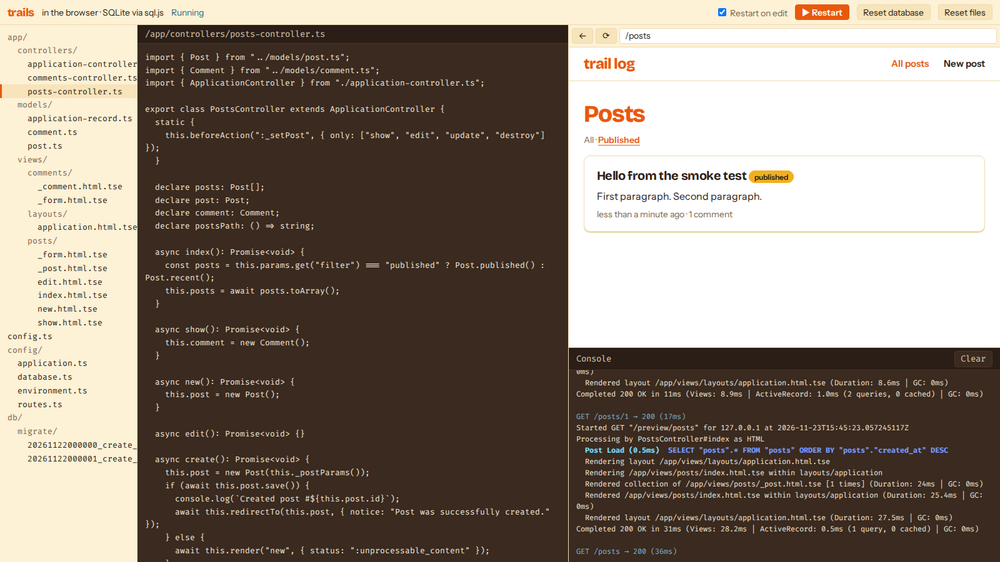
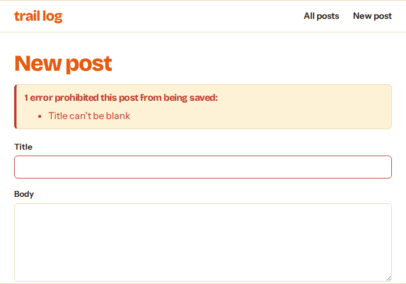
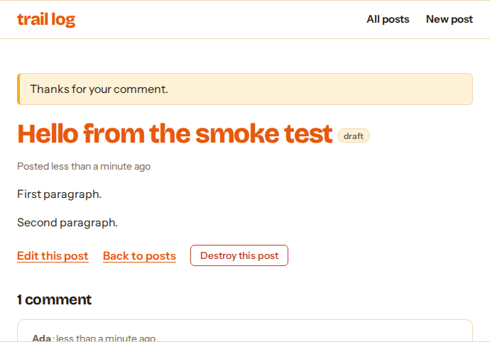
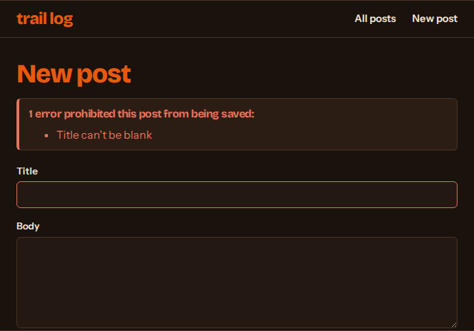
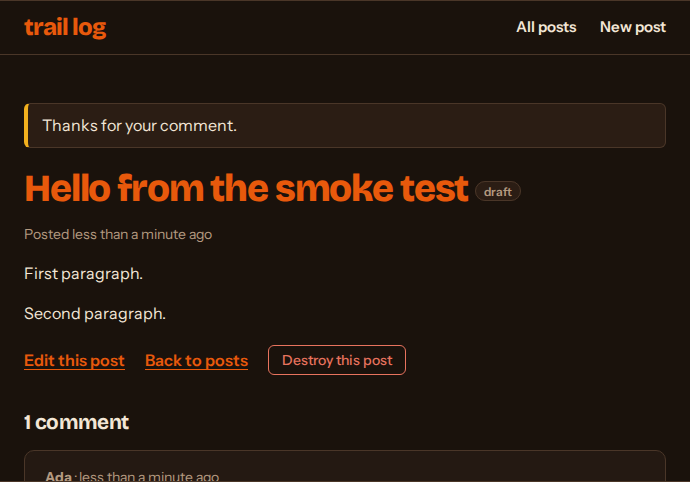
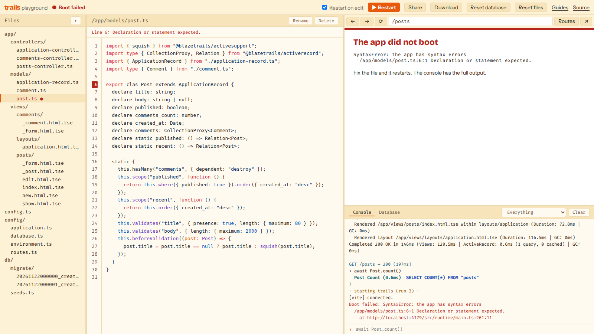
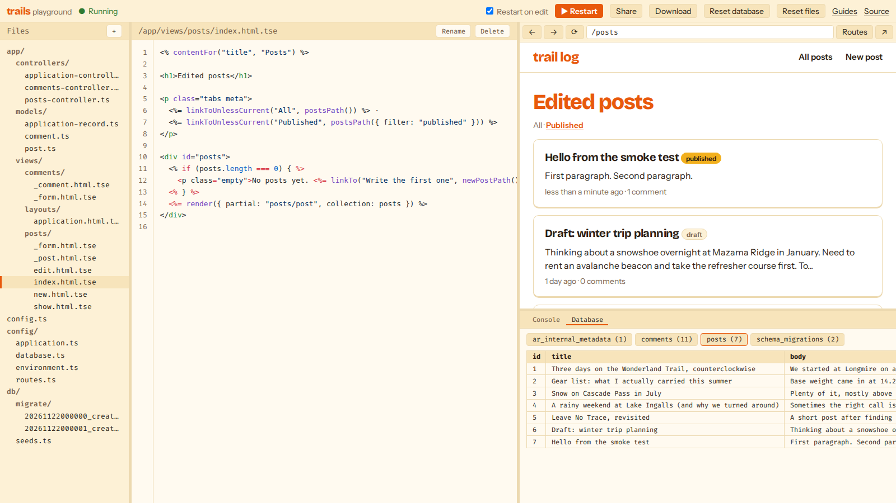
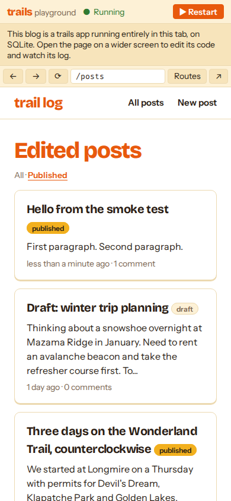
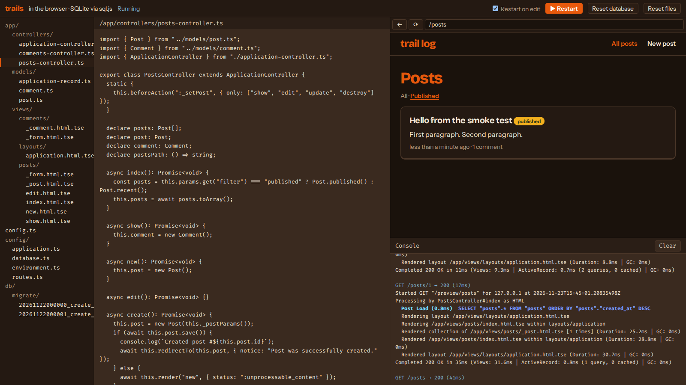

# trails in the browser, on SQLite

A trails application that runs entirely in a browser tab, on SQLite compiled to WebAssembly
(sql.js). The page is an editor: a file tree and editor over the app's source, a preview where
trails serves the app's pages, and a console showing the app's output, the Rails log included.
Edit a file and the app restarts with the change.

Around that loop the page has:

- **Files**: create, rename and delete files. A new model, controller or migration starts from a
  skeleton, and a migration waits for Restart, so a half-written one never runs
- **Errors where you look**: a syntax error names its file and line over the preview, in the file
  tree and in the editor's gutter; a template that does not compile says which one
- **A console line**: `await Post.count()` runs in the booted app with every model in scope, as
  `trails console` does
- **A database tab**: each table and its rows, read from the same SQLite database
- **Routes**: the preview's Routes button opens `/trails/info/routes`
- **Share and Download**: a link that carries the files changed from the example (in the URL
  fragment, never sent to a server), and the app as a `.zip`
- **One app per tab**: each tab runs its own runtime, and a preview keeps working after the
  browser stops the service worker
- **A phone** shows the running app alone; the editor needs a wider screen

```bash
pnpm dev     # Vite dev server; open the printed URL
pnpm build && pnpm preview   # a static bundle in dist/, served by vite preview
pnpm smoke   # headless Chromium: boot, create a post through the form, edit a view, restart
DIST=dist pnpm smoke   # the same walk over a built bundle (BASE=/playground/ for one built with --base)
BROWSER=firefox pnpm smoke   # or webkit; the service-worker stop step is Chromium-only (CDP)
```



The picker in the header switches between two example apps, each with its own saved files and
database: `templates/library/` is an API-only app (`config.apiOnly`, `ActionController.API`, JSON
responses) centred on associations and validations, and `templates/blog/` is a small blog, laid out the way `trails generate scaffold` lays one out
and styled with the trails website's brand (orange and mango, Bricolage Grotesque, Instrument
Sans and Fira Code), light or dark by the browser's color scheme. The layout loads its fonts from Google Fonts on purpose: it is ordinary app code that renders the same
under Node, and the editor's bundled fonts are not assets the app serves. Offline, the preview falls
back to system fonts. It runs unchanged under Node.

**Generate** in the file tree runs a real `bin/trails generate` (`model`, `migration`, `scaffold`,
`controller`…) in the runtime: trailties' generators and their templates are served from the
virtual filesystem, and the files they write join the tree. Ctrl+F (Ctrl+H) finds and replaces in
the open file. The database is kept in IndexedDB; a second tab on the same example runs its own
copy and is told nothing it changes is saved. In the console, framework frames of a trace fold
under "Framework Trace".

The blog exercises:

- **Routing**: `root`, `resources("posts")` with all seven actions, and `comments` nested under
  posts (`only: ["create", "destroy"]`)
- **Controllers**: a `beforeAction` loader, strong parameters (`params.expect`), flash notices
  through `redirectTo(..., { notice })`, `render("new", { status: ":unprocessable_content" })`
  for invalid input, and 303 redirects after a write
- **Models**: `hasMany("comments", { dependent: "destroy" })`, `belongsTo("post", { counterCache:
true })`, presence and length validations, a `beforeValidation` callback that squishes the
  title, and two named scopes (`published`, `recent`)
- **Views**: a layout with `contentFor("title")` and `csrfMetaTags`; `_form`, `_post` and
  `_comment` partials, with collection rendering; `formWith` on a record and on a nested
  `[post, comment]`; `linkTo`, `linkToUnlessCurrent`, `buttonTo` with `method: "delete"`, `domId`,
  `pluralize`, `truncate`, `simpleFormat` and `timeAgoInWords`
- **Seeds**: `db/seeds.ts`, a trip-report blog with drafts and comment threads, loaded when the
  database is first created, as `db:prepare` does. **Reset database** reseeds it
- **Migrations**: two, with a foreign key, a boolean default and a counter-cache column

It boots through `Trails.initialize()`, autoloads through Zeitwerk, migrates through
`MigrationContext`, and answers requests through `Trails.application.call`, as it would under
Node. `pnpm smoke` walks the whole thing; `SCREENSHOTS=<dir> pnpm smoke` (and `COLOR_SCHEME=dark` for the dark set)
saves the images here.

|       | A failed validation                                                 | A post and its comments                               |
| ----- | ------------------------------------------------------------------- | ----------------------------------------------------- |
| Light |  |  |
| Dark  |   |   |

A syntax error, the database tab, and the page at phone width:

| A syntax error                                                    | The database tab                                                | A phone                                             |
| ----------------------------------------------------------------- | --------------------------------------------------------------- | --------------------------------------------------- |
|  |  |  |

The editor in dark mode:



## How it fits together

| Piece                                                  | What it does                                                                                                                                                                                                                                                                                                                               |
| ------------------------------------------------------ | ------------------------------------------------------------------------------------------------------------------------------------------------------------------------------------------------------------------------------------------------------------------------------------------------------------------------------------------ |
| Editor (`index.html`, `src/host/`)                     | Highlights the source with Shiki (the website's `github-dark` theme, plus a small `.tse` grammar: HTML with TypeScript inside `<% %>`) behind a transparent textarea. Holds the files and the database bytes (both kept in `localStorage`), and recreates the runtime iframe on every restart, so each run evaluates a fresh module graph  |
| Runtime iframe (`runtime.html`, `src/runtime/main.ts`) | Loads the framework packages, registers the browser host adapters, boots the app, runs pending migrations, and answers requests                                                                                                                                                                                                            |
| Virtual filesystem (`src/runtime/vfs.ts`)              | An in-memory ruby-compat `FsAdapter`. Zeitwerk, the template resolver and the migrator read the app's files from it; the app's `log/development.log` is written to it and tailed into the console                                                                                                                                          |
| Service worker (`public/sw.js`)                        | Sends a tab's `/preview/<tab>/*` requests to that tab's runtime, which hands them to the Rack app with `SCRIPT_NAME=/preview/<tab>`, and serves the app's modules: `pathToFileURL("/app/models/post.ts")` is a `/rt/<tab>/<run>/vfs/...` URL the worker answers. It keeps no state: it finds the runtime frame by its URL on every request |
| Module loading (`src/runtime/modules.ts`)              | Transpiles an app file with TypeScript's `transpileModule`, and points its `@blazetrails/*` imports at shims that `export *` from the URL each package is served at (by the dev server, or as its own chunk in a build), so app code shares the framework's module instances and live bindings                                             |
| Templates (`src/runtime/template-compiler.ts`)         | A trails app precompiles `.tse` with `trails-tsc-views build`; here the source is in the editor, so `setTemplateCompiler` builds the same stand-in module from it at first render                                                                                                                                                          |
| SQLite (`src/runtime/expo-sqlite-sqljs.ts`)            | The app's `database.ts` says `adapter: "expo-sqlite"`; the runtime answers expo-sqlite's async API with sql.js, so the stock `SQLite3Adapter` runs unchanged                                                                                                                                                                               |

## What a browser needs that Node does not

`config/application.ts` sets no `secretKeyBase`: in development trails generates
`tmp/local_secret.txt`, as Rails does, and the editor keeps `tmp/` across restarts.

Each was hit booting this app in Chromium, and each is handled in this example rather than in
trails:

| Breakpoint                                                                                                                                      | Handled by                                                                                                                                |
| ----------------------------------------------------------------------------------------------------------------------------------------------- | ----------------------------------------------------------------------------------------------------------------------------------------- |
| No filesystem, process, OS or YAML backend                                                                                                      | `src/runtime/host.ts` registers a VFS, a single-process adapter, an OS adapter, and the npm `yaml` package as Psych's backend             |
| Web Crypto is async-only, but `KeyGenerator`'s `pbkdf2Sync` and the cookie jar's AES-256-GCM are synchronous                                    | `src/runtime/crypto.ts`, a crypto adapter on `@noble/hashes` and `@noble/ciphers`                                                         |
| Packages import Node built-ins at module scope (`zlib` in encryption, `net` and nodemailer in `mail`)                                           | `vite.config.ts` gives each built-in a module with the same export names that throws only when called; nodemailer's SMTP client is a stub |
| `@blazetrails/sqlite3` reaches expo-sqlite through `createRequire(import.meta.url)` and, in its engine, a computed `import()`                   | the `node:module` shim's `createRequire`, and `runtime.html`'s import map                                                                 |
| `Buffer` and `Temporal` are not browser globals                                                                                                 | the `buffer` and `@js-temporal/polyfill` packages, installed before anything loads                                                        |
| A response a service worker builds cannot set a cookie, and a page cannot send `Cookie` through `fetch`, so the session and CSRF token are lost | `src/runtime/cookie-jar.ts` keeps the preview's cookies and passes them as `HTTP_COOKIE`                                                  |
| The browser has no `AsyncLocalStorage`, so two overlapping requests share one execution context                                                 | the runtime handles one request at a time                                                                                                 |
