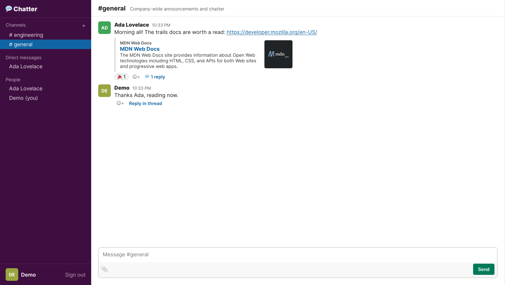
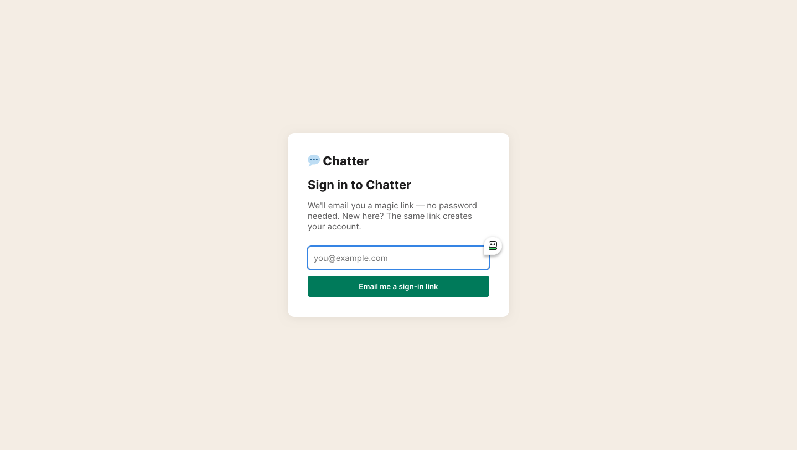
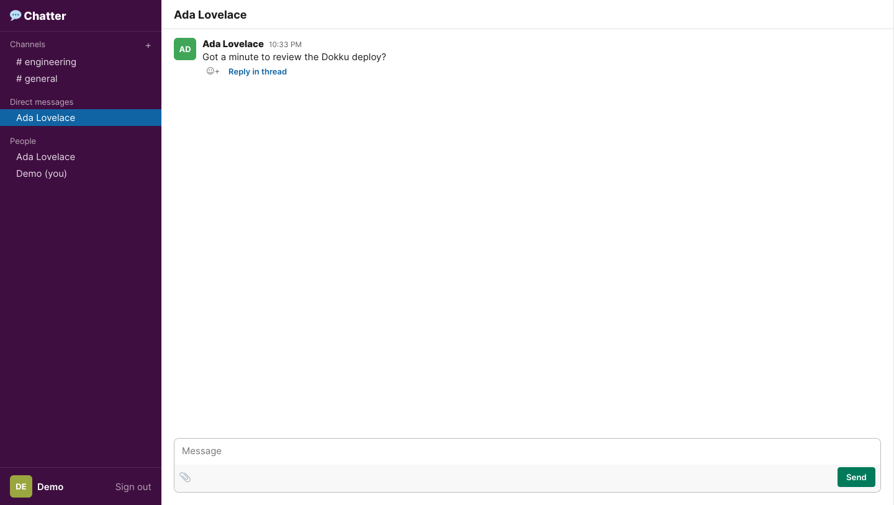

# Chatter — a Slack-style chat app on trails

A Hotwire chat app built on the full trails stack: Active Record models on MySQL, Action Pack
controllers, `.tse` views, Turbo Streams over Action Cable for live updates, Active Storage for
attachments, Active Job for link previews, and Action Mailer for passwordless sign-in.



| Sign in                                 | Direct message                               |
| --------------------------------------- | -------------------------------------------- |
|  |  |

## Features

- **Magic-link sign-in.** Enter an email address and Chatter emails a one-time link. There is no
  password: the first link also creates the account. Tokens come from `generatesTokenFor`, expire in
  15 minutes, and stop working once the user signs in (the token embeds `updated_at`, which the
  sign-in touches).
- **Channels.** `#general` is created on first visit. Anyone can create a channel, and visiting one
  joins it.
- **Direct messages.** Click a person in the sidebar to open (or create) a DM with them.
- **Messages with attachments.** Upload any files with the 📎 button. Images render inline and other
  files render as download links.
- **Link previews.** `LinkPreviewJob` fetches each URL in a message, reads its Open Graph and
  `<title>` tags, stores a `LinkPreview`, and re-broadcasts the message.
- **Threads.** "Reply in thread" opens the thread in the side panel's `thread` turbo-frame. Replies
  bump a `replies_count` counter cache on the parent.
- **Reactions.** Toggle one of six emoji on any message.
- **Live updates.** Every new message, reply, reaction and preview streams to everyone viewing the
  room or thread (`turboStreamFrom` + `broadcastAppendTo` / `broadcastReplaceTo`).

## Models

| Model         | Table           | Notes                                                                 |
| ------------- | --------------- | --------------------------------------------------------------------- |
| `User`        | `users`         | `email_address`, `name`, `hasOneAttached("avatar")`, magic-link token |
| `Session`     | `sessions`      | one row per signed-in browser, referenced by a signed cookie          |
| `Room`        | `rooms`         | `kind: "channel"` or `"direct"`; a DM's name is its sorted member ids |
| `Membership`  | `memberships`   | joins users to rooms, with `last_read_at`                             |
| `Message`     | `messages`      | `body`, `parent_id` for threads, `hasManyAttached("attachments")`     |
| `Reaction`    | `reactions`     | one emoji per user per message                                        |
| `LinkPreview` | `link_previews` | Open Graph data for a URL in a message                                |

## Running it locally

Build the workspace once from the repo root (`pnpm build`), and start a MySQL 8 server. Then, from
this directory:

```sh
docker run -d --name chatter-mysql -e MYSQL_ALLOW_EMPTY_PASSWORD=yes -p 127.0.0.1:3306:3306 mysql:8
pnpm build              # compile the views and build app/javascript with Vite
bin/trails db:prepare   # create and migrate chatter_development
bin/trails server       # http://localhost:3000
```

`DB_HOST`, `DB_PORT`, `DB_USERNAME` and `DB_PASSWORD` override the connection
(`config/database.ts`). In development, sign-in emails are written to `tmp/mails/<address>`
instead of being sent. Open the link from there.

## Tests

The tests run against MySQL (`chatter_test`), like the app:

```sh
bin/trails db:prepare TRAILS_ENV=test
pnpm test
```

- `test/models/`: `User` (normalization, magic-link tokens and their invalidation), `Room` (channel
  validation, one direct room per pair, titles), and `Message` (body-or-attachment rule, attachments,
  URL extraction, the reply counter cache, reaction grouping).
- `test/integration/magic-link-sign-in.test.ts`: signs in end to end through the emailed link, checks
  that the link works once, and rejects a tampered one.

## Deploying to Dokku

The deploy builds the image on the Dokku host from a staged copy of the monorepo (the workspace
packages are not published to npm), then hands it to Dokku with `git:from-image`.

One-time setup:

```sh
sudo dokku plugin:install https://github.com/dokku/dokku-mysql.git mysql
dokku apps:create chatter
dokku domains:set chatter chatter.deanoftech.com
dokku mysql:create chatter-db
dokku mysql:link chatter-db chatter            # sets DATABASE_URL
dokku mail:link default chatter                # sets SMTP_HOST / SMTP_PORT
dokku config:set chatter SECRET_KEY_BASE=$(openssl rand -hex 64) APP_HOST=chatter.deanoftech.com
dokku storage:ensure-directory chatter
dokku storage:mount chatter /var/lib/dokku/data/storage/chatter:/trails/examples/chatter/storage
dokku ports:set chatter http:80:5000
dokku letsencrypt:enable chatter
```

Each deploy (run `pnpm build` at the repo root first):

```sh
bin/deploy            # or: bin/deploy <app-name>
```

`bin/docker-entrypoint` runs `db:prepare` before the server starts, so migrations apply on every
deploy. Uploads are stored on the mounted `storage/` volume (Active Storage's Disk service).

### Production configuration

| Variable           | Set by       | Purpose                                                                                          |
| ------------------ | ------------ | ------------------------------------------------------------------------------------------------ |
| `DATABASE_URL`     | `mysql:link` | MySQL connection, merged over `config/database`                                                  |
| `SMTP_HOST`/`PORT` | `mail:link`  | outgoing mail relay                                                                              |
| `SECRET_KEY_BASE`  | `config:set` | cookies, magic-link tokens, signed stream names                                                  |
| `APP_HOST`         | `config:set` | host used in emailed links                                                                       |
| `MAILER_FROM`      | `config:set` | sender address; its domain must be verified with the mail relay (Resend rejects others with 550) |
| `FORCE_SSL`        | `config:set` | set to `false` to serve over plain HTTP                                                          |

Jobs and Action Cable use the in-process `async` adapters, so run a single web process.
